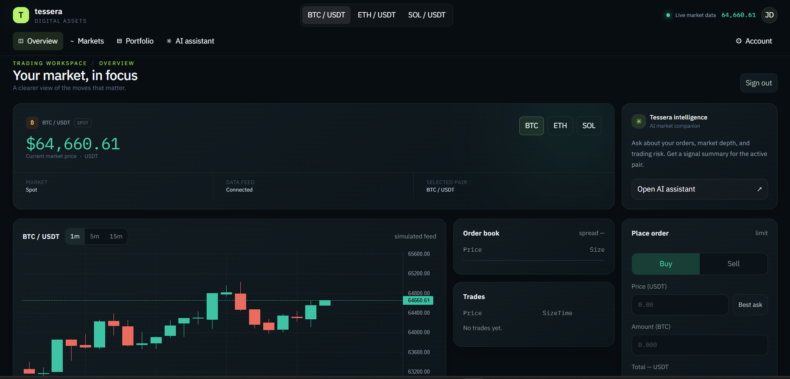
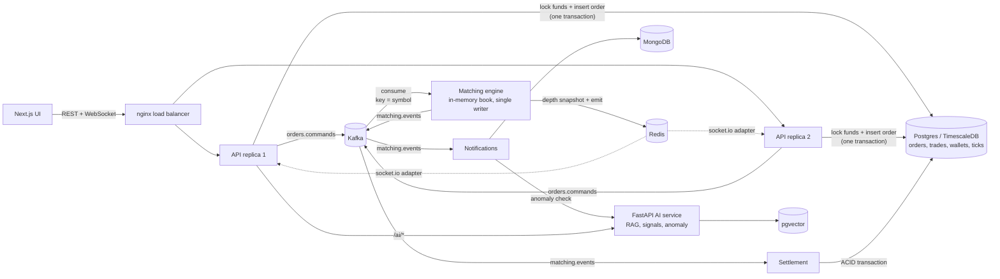
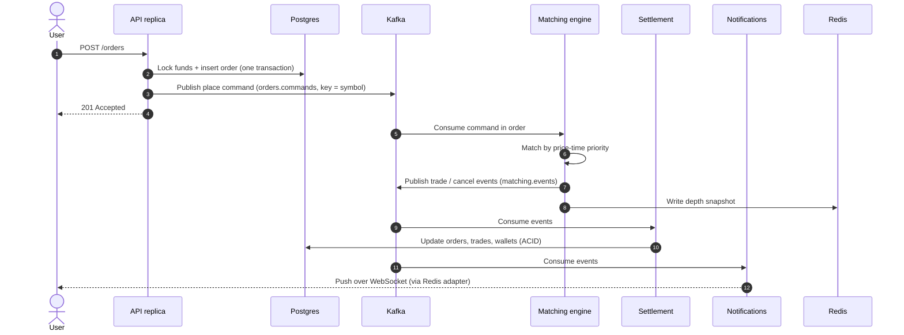

# Tessera: Real-Time Trading Platform

An event-driven trading platform built around a price-time-priority matching engine and a Kafka event log. Orders are matched deterministically, settled atomically in Postgres, and streamed live to a Next.js trading terminal over horizontally scalable WebSockets.

It also includes TimescaleDB market data, MongoDB notifications, and a Python AI service (RAG assistant, anomaly detection, technical signals). Fully self-hosted with Docker.




> Replace the image above with a screenshot of the trading terminal. A short GIF of an order being placed and the order book updating live works even better.

## Table of Contents

- [Highlights](#highlights)
- [Tech stack](#tech-stack)
- [Performance](#performance-local-load-tests)
- [Quick start](#quick-start)
- [Architecture](#architecture)
- [Design decisions](#design-decisions)
- [Repository layout](#repository-layout)
- [Tests](#tests)
- [Load testing](#load-testing)
- [Status and known limitations](#status-and-known-limitations)
- [Roadmap](#roadmap)
- [Author](#author)

## Highlights

- **Deterministic matching.** A single-writer, in-memory order book per symbol, fed by Kafka (key = symbol) so each symbol's orders are processed in strict sequence. Price-time priority, fills at the maker's price, self-trade prevention.
- **Exact money.** Scaled integers and `BigInt` at the wallet boundary, so no floats touch money. A 20,000-order randomized simulation confirmed that totals are conserved, no balance goes negative, and nothing stays locked after cancels.
- **Safe under redelivery.** At-least-once Kafka processing made idempotent: trade inserts use `ON CONFLICT DO NOTHING`, cancels are status-guarded, and the engine skips orders already on the book.
- **Scales horizontally.** Stateless API replicas behind nginx. WebSockets use the Socket.io Redis adapter with websocket-only transport, so no sticky sessions are needed.
- **Fails gracefully.** The AI service sits behind a circuit breaker and timeouts, so AI failures never block trade processing.
- **Observable.** Prometheus metrics, OpenTelemetry traces to Jaeger, JSON logs to Loki, and a provisioned Grafana dashboard.

## Tech stack

| Layer | Technology |
|---|---|
| Backend | NestJS, TypeScript, Socket.io |
| Frontend | Next.js 14 (App Router), React, TypeScript |
| Messaging | Apache Kafka |
| Databases | PostgreSQL + TimescaleDB, MongoDB, Redis, pgvector |
| AI service | FastAPI (Python): RAG, anomaly detection, SMA/RSI signals, sentiment |
| Infra and tooling | Docker Compose, nginx, Kubernetes manifests, GitHub Actions, k6 |
| Observability | Prometheus, Grafana, OpenTelemetry, Jaeger, Loki |

## Performance (local load tests)

Measured with the k6 scripts in `infra/k6/`. All runs were on a single laptop running k6, Docker, Kafka, Postgres and two API replicas together, so treat the figures as local results, not production capacity.

| Test | Result |
|---|---|
| **Order intake** (`orders-load.js`, ramp to 150 orders/s across 100 users) | 7,649 orders accepted, **0 errors**, median **22.6 ms**, p95 **249 ms**, no dropped iterations |
| **Order intake, breakpoint** (ramp to 400 orders/s, auto-abort on p95 > 500 ms) | Latency crossed 500 ms at roughly 165 orders/s; no requests failed |
| **WebSocket fan-out** (`ws-load.js`, up to 1,000 concurrent clients) | 2,003 sessions, **0 failed connections**, p95 connect **21 ms**, about **1.8k messages/s** delivered |

Notes on reading these numbers:

- Order latency is **acceptance latency**: `POST /orders` returns once funds are locked and the command is published to Kafka. Matching and settlement happen asynchronously afterwards.
- An early run with a single test user showed a 1.4 s p95 and 23% rejections because every order locked the same wallet row (the rejections were insufficient-balance errors). Spreading load across 100 wallets removed both. Wallet-row lock contention is the most likely cause of the latency, though not a confirmed one.
- The breakpoint figure is estimated from the ramp timing at the moment k6 aborted.

To reproduce, see [Load testing](#load-testing).

## Quick start

Requires Docker with Compose v2.

```bash
git clone https://github.com/gauravv700/<your-repo-name>.git
cd <your-repo-name>
cp .env.example .env
docker compose up --build
```

| What | Where |
|---|---|
| Trading UI | http://localhost:3000 |
| API + WebSocket (nginx to 2 API replicas) | http://localhost:8080 |

1. Open the UI and create a demo account. It starts with 100,000 USDT, 2 BTC, 30 ETH and 500 SOL of play money.
2. Market-maker bots quote both sides and a taker bot crosses the spread, so the order book and trade tape are live immediately.
3. Place a limit order from the form. Fills appear in *Activity*, balances update and the chart streams ticks.

Optional extras:

```bash
make obs                              # adds Prometheus, Grafana (:3001, admin/admin), Jaeger (:16686), Loki
docker compose --profile llm up -d    # adds Ollama; then pull a model and set OLLAMA_URL in .env
docker compose exec ollama ollama pull llama3.2
```

The AI assistant works with **no LLM at all** (extractive answers from the knowledge base). Set `ANTHROPIC_API_KEY` or `OLLAMA_URL` for generated answers.

Without Docker, the backend also runs against local Postgres (Timescale) and Redis with no Kafka (`KAFKA_BROKERS` unset uses an in-memory event bus).

## Architecture



### Order lifecycle



1. `POST /orders` runs one Postgres transaction that locks funds and inserts the order, then publishes a `place` command to `orders.commands` (keyed by symbol).
2. The matching engine (single writer per symbol shard) consumes commands in order, matches by price-time priority and publishes `trade` and `cancel` events to `matching.events`.
3. Independent consumer groups react to the same event log. **Settlement** updates orders, trades and wallets in one ACID transaction. **Notifications** write to MongoDB, push over WebSocket and run an anomaly check.
4. The engine writes the book to Redis (`depth:<symbol>`), the CQRS read model behind `GET /market/depth` and the WebSocket snapshots.

### What each data store is for

| Store | Used for |
|---|---|
| **Kafka** | Event log: `orders.commands` (inputs) and `matching.events` (trades and cancels) |
| **Postgres / TimescaleDB** | System of record: orders, trades, wallets, and time-series ticks |
| **Redis** | Order-book read model, rotating refresh tokens, Socket.io adapter |
| **MongoDB** | User notifications |
| **pgvector** | Embeddings for the AI assistant's RAG knowledge base |

### Roles

One image, selected by `ROLES=api,matching,settlement,notifications,marketdata,bot`. The `api` role is stateless and scales horizontally. The others run as a single-replica worker (in Compose and Kubernetes).

## Design decisions

| Decision | Why |
|---|---|
| Scaled integers and `BigInt` for money | No floating-point drift; conservation of totals is checked by a 20,000-order simulation |
| Kafka key = symbol | One partition per symbol gives strict per-symbol ordering |
| Trades and cancels share one topic | A consumer can never see a cancel before an earlier fill |
| Idempotent consumers instead of "exactly once" | Simpler, and safe under redelivery |
| Redis snapshot as the order-book read model (CQRS) | API replicas never touch engine memory |
| Rebuild the book from open orders in Postgres on boot | Crash recovery without a separate snapshot store |
| Websocket-only transport plus Redis adapter | Horizontal scaling with no sticky sessions |
| Circuit breaker around the AI service | AI outages cannot affect trading |

### Security

- Short-lived JWT access tokens and rotating refresh tokens stored in Redis, with reuse detection: replaying a rotated refresh token revokes the whole session family.
- bcrypt password hashing, Helmet headers and validation pipes with allow-listed DTOs.
- Per-route rate limits (stricter for auth and AI).

## Repository layout

```
backend/      NestJS (TypeScript): API, WebSocket gateway, matching engine, settlement, bots
frontend/     Next.js 14 App Router (TypeScript): trading terminal
ai-service/   FastAPI: RAG (memory or pgvector), anomaly detection, SMA/RSI signal, sentiment
infra/        nginx, Prometheus, Grafana, Loki, Kubernetes manifests, k6 scripts
docker-compose.yml, docker-compose.observability.yml, .github/workflows/ci.yml, Makefile
```

## Tests

```bash
cd backend && npm install && npm test              # matching engine, units, circuit breaker
cd ai-service && pip install -r requirements.txt && pytest -q
```

CI (`.github/workflows/ci.yml`) runs on GitHub Actions and builds the container images.

## Load testing

Requires [k6](https://k6.io/docs/get-started/installation/).

```bash
make load-orders     # or: k6 run infra/k6/orders-load.js
make load-ws         # or: k6 run infra/k6/ws-load.js
```

**Rate limiting.** The API enforces per-IP limits, and k6 sends all traffic from one IP. For local load tests only, start the API with `LOAD_TEST=true` to skip the throttler (for example, `LOAD_TEST: "true"` in the `api` service environment in Compose). Never set it in production.

The order test registers 100 users (override with `-e USERS=200`) and spreads orders across them so a single wallet is not a hotspot. It counts only HTTP 201 as a success.

## Status and known limitations

This is an actively developed project, and these are the known gaps:

- **Simulated market data.** Prices are a random walk seeded on first boot. The feed is one function (`MarketDataService.next`) that you can replace with a real exchange WebSocket.
- **Limit orders only.** No market orders, fees or margin.
- **Transactional outbox missing.** If Kafka is down after the order row commits, the order is compensated (cancelled and funds released), but a hard crash in that window could leave funds locked. A transactional outbox closes this gap.
- **Single writer per shard.** The matching engine is in memory. Scale by sharding symbols across workers, not by adding replicas. Failover is "restart and rebuild from Postgres".
- **Schema.** `DB_SYNC=true` uses TypeORM auto-sync for convenience. Use migrations in production (the Kubernetes config sets it to false).
- **Not included:** TOTP 2FA, a Helm chart (plain Kubernetes manifests instead), ELK (Loki is used for logs), stateful data stores in Kubernetes (use managed Postgres, Redis and Kafka), Redis-backed rate-limit storage and a trained ML model (signals are a documented SMA/RSI heuristic).
- **Tokens** are kept in `localStorage` for simplicity; httpOnly cookies are safer against XSS.

## Roadmap

- [ ] Transactional outbox for order publishing
- [ ] Symbol sharding across matching workers
- [ ] Standby engine that replays the event log to keep a warm book
- [ ] Market orders and fees
- [ ] httpOnly cookie auth and TOTP 2FA

## Cost

Everything runs free on your own machine. The Anthropic API (pay-per-token) and cloud hosting are optional; Ollama is the free alternative for LLM answers.

## Author

**Gaurav Kumar**
[LinkedIn](https://linkedin.com/in/gaurav700) · [GitHub](https://github.com/gauravv700) · [Portfolio](https://gaurav700.vercel.app)

If you found this project useful, consider giving it a ⭐
